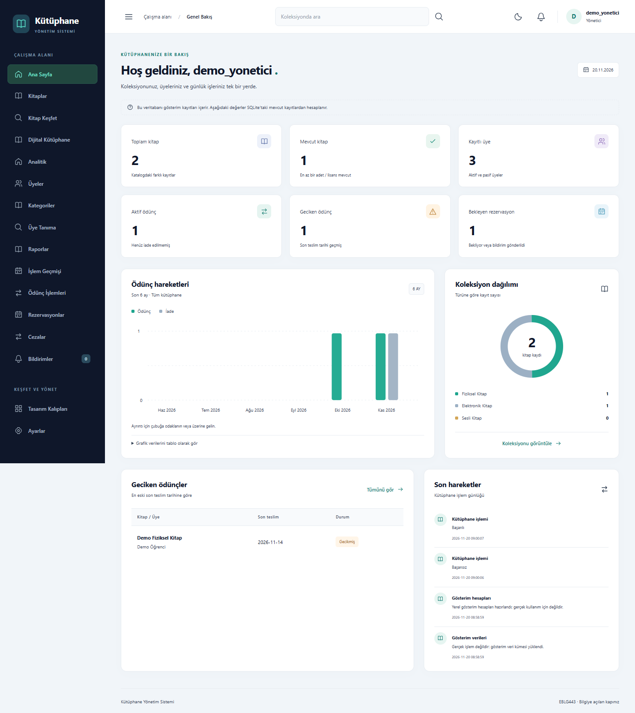

# Kütüphane Yönetim Sistemi

**EBLG443 — Tasarım Kalıpları | Proje Gelişimi 1**

Python ve Flask ile geliştirilen bu uygulamada kitap, üye, ödünç, iade ve rezervasyon işlemleri yönetilir. Projede dört GoF tasarım kalıbı kullanılmıştır.

## Teknolojiler

Python 3.11+, Flask, SQLite, HTML, CSS, JavaScript ve pytest.

## Tasarım kalıpları

| Kalıp | Projedeki kullanımı | Kaynak kod |
| --- | --- | --- |
| Factory Method | Fiziksel, elektronik ve sesli kitap oluşturma | [factory_method.py](patterns/factory_method.py) |
| Adapter | Google Books ve Open Library verilerini ortak biçime dönüştürme | [adapter.py](patterns/adapter.py), [open_library_adapter.py](patterns/open_library_adapter.py) |
| Strategy | Üye türüne göre gecikme cezası hesaplama | [strategy.py](patterns/strategy.py) |
| Observer | Kitap iadesinden sonra rezervasyon sahibine bildirim gönderme | [observer.py](patterns/observer.py) |

## Kurulum (Windows PowerShell)

Komutları `app.py` dosyasının bulunduğu proje klasöründe çalıştırın:

```powershell
python -m venv venv
venv\Scripts\Activate.ps1
python -m pip install -r requirements.txt
Copy-Item .env.example .env
```

`.env` dosyasındaki `SECRET_KEY` alanını yerel bir güvenli anahtarla doldurun. Ayrıntılar [kurulum kılavuzunda](docs/KURULUM.md) yer alır. `.env` dosyasını GitHub'a yüklemeyin.

**İlk kurulumda (yeni veritabanı):**

```powershell
python.exe -m flask --app app:create_app init-db
python.exe -m flask --app app:create_app seed-demo
python.exe -m flask --app app:create_app demo-accounts
python.exe -m flask --app app:create_app check-db
python.exe -m flask --app app:create_app run --host 127.0.0.1 --port 5000
```

Tarayıcıda [http://127.0.0.1:5000/giris](http://127.0.0.1:5000/giris) adresini açın. Sonraki kullanımlarda sanal ortamı etkinleştirip yalnızca `run` komutunu çalıştırın; mevcut veritabanını yeniden oluşturmayın.

## Testler

```powershell
python -m pytest -q
```

## Belgeler

- [Kurulum](docs/KURULUM.md)
- [Testler](docs/TEST.md)
- [Tasarım kalıpları ve UML](docs/TASARIM_KALIPLARI.md)
- [Gösterim adımları](docs/DEMO.md)

## Ekran görüntüsü


