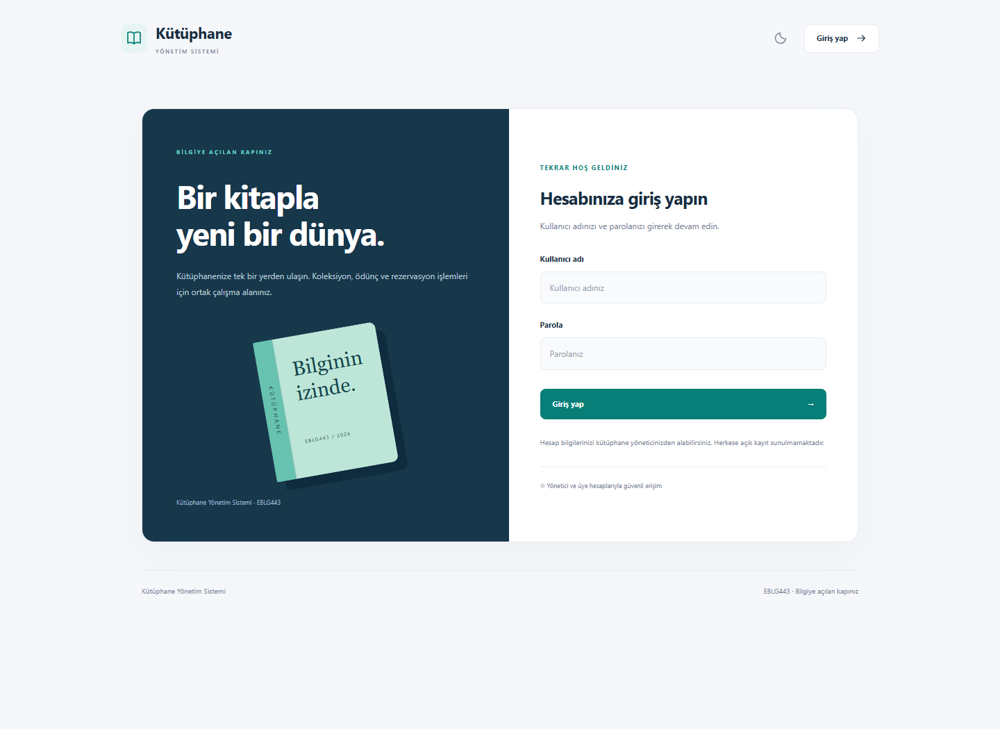

# Kullanım Kılavuzu

## Gezinme ve görünüm

Üst çubuktaki arama tüm yerel katalogda çalışır. Masaüstünde kenar menüsü daraltılabilir. Telefonda **Menüyü aç** düğmesi gezinmeyi açar ve Escape kapatır. Açık, koyu ve sistem teması **Ayarlar** bölümünden seçilebilir.

## Raporlar

Yönetici **Raporlar** ekranında rapor türünü ve tarih aralığını seçer. Önizlemede görünen dönem ve veriler aynı parametrelerle PDF, Excel ve CSV olarak indirilebilir veya yazdırılabilir.

## Analitik

Yönetici **Analitik** ekranında başlangıç ve bitiş tarihi seçebilir. Grafiklerin veri tabloları açılabilir. Koleksiyon, stok ve aktif kayıtlar güncel durumu; tarihli hareketler seçilen dönemi gösterir. Dijital okuma grafikleri üye ve kitap başına tutulan son ilerleme kayıtlarını sayar.

## Ödünç politikaları ve bildirimler

Yönetici **Ayarlar → Ödünç ve ceza politikaları** ekranında üye türü başına ücret, süre, limit, yenileme ve toleransı ayarlar. İade edilmiş ödünçlerde kesin ceza tutarı korunur. Etkin ödünç **Süreyi uzat** düğmesiyle yenilenir. Başka bir üye bekliyorsa, ödünç gecikmişse veya yenileme hakkı bittiyse işlem reddedilir.

**Bildirimler** ekranında tür filtresi, toplu okundu işlemi ve üye tercihleri bulunur. Ayırma süreleri ve hatırlatmalar için:

```powershell
.\.venv\Scripts\python.exe -m flask --app app:create_app refresh-circulation
```

Windows Görev Zamanlayıcı’da veya cron’da uygulama dizininden bu komutu beş dakikada bir çalıştırın. Aynı olay tekrar çalıştırıldığında bildirim yinelenmez.

## Üye kartı ve üye tanıma

Üye **Üye Kartım** ekranından QR kodunu gösterir, PDF/PNG indirir veya kartı yazdırır. Yönetici **Üye Tanıma** ekranında kamera izni vererek QR kodunu tarar. Kamera açılamazsa üye numarası girilebilir. Bulunan kayıttan ödünç formuna üye seçili olarak geçilir ve etkin ödünçler için iade bağlantıları görünür. QR kod yalnız rastgele kart kimliğini içerir.

## Üye rafı

Katalogdaki **Favoriye ekle** ve **Okuma listesine ekle** işlemleri kişisel rafınıza yazar. **Kitaplarım** kaydedilen kitapların kategorilerine göre öneriler sunar. **Okuma Geçmişim** kişisel dijital ilerlemeyi gösterir. **Profilim** ad ve e-posta değişikliklerini, **Ayarlar** parola değişikliğini sağlar.

## Dijital Kütüphane

PDF okuyucusundaki **Metin görünümü** metni seçilebilir olarak sunar. **PDF'de ara** eşleşen sayfaları listeler. Taranmış PDF'lerde gömülü metin yoksa sayfa görüntüsünü kullanın. **Kitaplarım** bölümünden son sayfayı veya dinleme konumunu görüp **Kaldığın yerden devam et** bağlantısını açabilirsiniz.

Yerel gösterim veritabanında `seed-demo` ve `demo-accounts` sonrasında `python -m flask --app app:create_app demo-reading` komutu, demo üyesine PDF ödüncü hazırlar. İade kaydedildiğinde üyenin dosya ve okuyucu erişimi sona erer.

Yönetici, **Kitaplar → Kitap ekle** ekranında Elektronik Kitap için PDF, Sesli Kitap için MP3 veya PCM WAV yükleyebilir. Sınır 32 MB’dır. Yalnızca dağıtım hakkı kütüphaneye ait dosyalar yüklenebilir ve formda hak onayı gerekir.

Etkin ödüncü olan üye **Dijital Kütüphane** bölümünden kitabı açar. PDF okuyucuda sayfa, yakınlaştırma, tam ekran ve ayraç denetimleri vardır. Ses oynatıcı, konumu kaydeder ve tarayıcıya uygun ses, hız ve oynatma denetimleri sunar. Kişisel konum ve ayraçlar sonraki açılışta geri yüklenir. Mevcut harici elektronik kitap adresleri katalogda kalır.

**Ders:** EBLG443 — Tasarım Kalıpları

**Proje:** Kütüphane Yönetim Sistemi · Aşama 11

## 1. Sisteme giriş ve gezinme

Önce [kurulum adımlarını](KURULUM.md) tamamlayın. Sunucu çalışırken http://127.0.0.1:5000/giris adresini açın. Kullanıcı adı ve parolanızı girip **Giriş yap** düğmesini kullanın. Hatalı ya da pasif hesap için genel Türkçe hata gösterilir. Deneme hesapları yalnız yerel gösterim içindir; [kurulumdaki hesap tablosuna](KURULUM.md) bakın.



Başarılı giriş `/panel` sayfasına yönlendirir. Sol menüden sayfa seçilir; dar ekranda menü düğmesi kullanılır. Üstte profil, tema düğmesi ve kişisel okunmamış bildirim sayısı bulunur. **Çıkış yap**, aynı hesabın bütün mevcut oturumlarını kapatır. Oturum 30 dakika sonra sona erer; süre her istekle otomatik uzamaz.

| İşlem | Yönetici | Üye |
| --- | --- | --- |
| Panel, katalog, simülatör, eğitim ve ayarlar | Erişir | Erişir |
| Kitap ekle/düzenle/sil, Google araması/aktarımı | Erişir | Erişemez |
| Üye dizini, hesap oluşturma, pasifleştirme, üye geçmişi | Erişir | Erişemez |
| Ödünç verme ve iade kaydı | İşlemi yapar | Kendi kayıtlarını izler |
| Rezervasyon | Uygun üye adına oluşturur/iptal eder | Kendi adına oluşturur/iptal eder |
| Bildirimler | Yalnız bağlı kendi üye kaydı varsa kendi bildirimleri | Yalnız kendi bildirimleri |

Yönetici olmak başka üyelerin özel bildirimlerini okuma yetkisi vermez. Menüde düğmenin gizlenmesi tek koruma değildir; sunucu yetkiyi ayrıca denetler.

## 2. Panel ve görünüm tercihleri

**Genel Bakış**, SQLite'taki güncel verileri gösterir. Yönetici tüm sistem sayılarını; üye kendi dolaşım/bildirim sayılarını görür. Koleksiyon tür dağılımı genel katalogdur. **Toplam kitap**, farklı kitap kaydı sayısı; **Mevcut kitap**, en az bir kopyası/lisansı bulunan kayıt sayısıdır. Gösterim verisi varsa uyarı görünür. Grafikler son altı ayı, gecikenler bölümü en erken teslimli beş kaydı gösterir.

**Ayarlar** üzerinden açık, koyu veya sistem teması ile rahat/kompakt tablo yoğunluğu seçilir. Tercihler yalnız bu tarayıcıda tutulur. Bu ekran parola veya API anahtarı değiştirmez; yöneticide yalnız anahtarın tanımlı olup olmadığı görünür.

## 3. Kitap ekleme, düzenleme, arama ve silme

1. Yönetici olarak **Kitaplar → Kitap ekle** yolunu açın.
2. **Fiziksel Kitap** veya **Elektronik Kitap** seçin.
3. Başlık (1–200 karakter), yazar (1–160 karakter), adet/lisans (1–10000) girin. Kategori ve ISBN isteğe bağlıdır.
4. Fiziksel kitapta raf konumu (en fazla 80 karakter), elektronik kitapta geçerli HTTP/HTTPS dosya adresi zorunludur. Karşı türe ait alanı boş bırakın. JavaScript kapalıysa iki alan görünebilir; yine yalnız ilgili olanı doldurun.
5. **Kitabı ekle** ile kaydedin. Factory Method seçilen ürünü üretir ve doğrular.

ISBN varsa doğru kontrol basamaklı ISBN-10/13 olmalıdır; tireler normalize edilir. Eşdeğer ISBN-10/13 ile tekrar kayıt reddedilir. Google kapak görseli ve dış kaynak kimliği kalıcı kitap alanı olarak tutulmaz. E-kitap adresi sunucuda dosya yükleme/indirme başlatmaz.

Katalog araması başlık, yazar veya ISBN üzerinde yapılır. Türkçe I/İ eşlemesi uygulanır; `%` ve `_` kullanıcı girdisinde gerçek karakter olarak aranır. Sonuçlar 20'şer sayfalanır. **Düzenle**, aynı kurallarla günceller. Toplam adet aktif ödünç sayısının altına indirilemez. Ödünç/rezervasyon geçmişi olan kitabın türü değiştirilemez.

**Sil** önce onay sayfasını açar; POST onayı kaydı siler. Geçmişli kitap silinemez, açıklama gösterilir. İşlem geçmişini korumak için doğrudan veritabanından silme yapılmamalıdır.

## 4. Harici katalog entegrasyonu

1. Giriş yaptıktan sonra **Kitap Keşfet** sayfasını açın.
2. Başlık, yazar veya ISBN alanlarından en az birini doldurun. Birden fazla alan birlikte aranır.
3. Google Books veya Open Library kaynağını seçip **Ara** düğmesine basın. Bir sayfada en fazla 12 sonuç görüntülenir.
4. **Ayrıntıları gör** ile kitabın bilgilerini açın. Yöneticiyseniz **İçe aktar ve düzenle** ile taslağı açabilirsiniz.
5. Kapak, açıklama ve bibliyografik alanları kontrol edin. Eksik bilgileri tamamlayın. Tür, adet/lisans, raf veya dosya adresini belirleyip **Kitabı ekle** ile kaydedin.

Arama alanları seçilen sağlayıcıya gönderilir. Sağlayıcıya erişimde sorun çıkarsa uygulama diğer kaynağı dener ve sonuçların kaynağını gösterir. [Harici katalog kılavuzu](ADAPTER.md)

## 5. Üye yönetimi

Yönetici **Üyeler → Üye ekle** ile ad soyad, benzersiz e-posta ve tür seçer: **Öğrenci**, **Öğretmen**, **Normal Üye**. Üye türü ceza tarifesini belirler. E-posta için biçim kontrolü vardır; e-posta doğrulama mesajı gönderilmez.

İsteğe bağlı hesap alanlarında 3–80 karakterlik kullanıcı adı ve 8–256 karakterlik parola girilirse bağlı **Üye** hesabı aynı transaction içinde oluşturulur. Yalnız bir alanı doldurmak yeterli değildir. Bu formdan Yönetici rolü verilemez. Giriş hesabı olmadan üye kaydı oluşturulabilir; yönetici bu kişiye ödünç verebilir.

**Düzenle** ad, e-posta ve türü değiştirir. Hesabı olmayan mevcut üyeye hesap bağlanabilir; zaten bağlı hesabın kullanıcı adı/parolası bu formdan değiştirilemez. **Pasifleştir** onayı yeni ödünç/rezervasyonu engeller ve bağlı oturumları iptal eder. Geçmiş silinmez; mevcut ödünç geri alınabilir. **Etkinleştir** sonrasında yeniden giriş gerekir. **Geçmiş** ekranı son 50 ödüncü ve kaydedilmiş kesin cezaları gösterir.

## 6. Ödünç alma

Ödünç kaydını Yönetici yapar. **Ödünç İşlemleri → Ödünç ver** üzerinden kullanılabilir kitap ve aktif üye seçin, son teslim tarihini belirleyin. Varsayılan tarih 14 gün sonrasıdır; ödünç gününden önce olamaz. Ödünç tarihi sunucunun Türkiye takvim günüdür.

Stok, aynı kitap için aktif ödünç tekrarı, hesap aktifliği ve rezervasyon kuyruğu sunucuda denetlenir. Kuyruk varsa ilk uygun üye önceliklidir; başka üye için kayıt reddedilir. Başarılı kayıtta ilgili bekleyen rezervasyon fulfilled olur. Kitap mevcut değilse ödünç yerine rezervasyon kullanılır.

Üye **Ödünç İşlemleri** sayfasında yalnız kendi aktif kayıtlarını veya iade geçmişini izler; doğrudan ödünç verme/iade POST işlemi yapamaz.

## 7. Kitap iadesi ve gecikme cezası

Yönetici aktif ödünçte **İade al** seçer, önizlenen gecikme ve tutarı kontrol edip formu onaylar. İade tarihi kullanıcıdan alınmaz; sunucunun işlem günüdür. İade, stok görünümü, ceza, işlem günlüğü ve varsa bildirimler birlikte kesinleşir. Hata olursa işlem bütünüyle geri alınır. Aynı kayıt ikinci kez iade edilemez.

| Üye türü | Günlük ceza |
| --- | --- |
| Öğrenci | 2,00 TL |
| Öğretmen | 1,00 TL |
| Normal Üye | 5,00 TL |

Son teslim günü veya önceki iadede ceza sıfırdır. Aktif kayıtta **Bugünkü tahmin**, iade kaydında **Kesin tutar** gösterilir. İade anındaki güncel üye türü kullanılır; sonradan tür değişikliği kesin tutarı değiştirmez. Sistem cezayı kaydeder; tahsilat yapmaz.

**Ceza simülatörü**, üye türü, son teslim ve örnek iade tarihiyle aynı Strategy hesaplayıcısını çalıştırır; gerçek ödüncü değiştirmez. Geç iade gösterimi için gerçek kaydın tarihini değiştirmek yerine simülatörü veya yalıtılmış testleri kullanın.

## 8. Rezervasyon

Mevcut adedi sıfır olan kitapta **Rezerve et** veya **Rezervasyonlar → Rezervasyon oluştur** kullanılır. Üye kendi adına, Yönetici uygun üye adına oluşturur. Mevcut kitap rezerve edilemez. Aynı kitap için aktif ödüncü olan kişi veya active/notified rezervasyonu olan kişi ikinci aktif kayıt oluşturamaz.

Sıra oluşturulma zamanı, eşitlikte kayıt kimliği ile belirlenir. **Bekliyor** active, **Bildirim gönderildi** notified durumudur. Pasif üyeler/hesaplar uygun sıra hesabına alınmaz. **İptal et** onayından sonra kayıt geçmişe taşınır; tamamlanmış/iptal edilmiş kayıt yeniden iptal edilemez. Üye başkasının kaydını göremez veya iptal edemez.

## 9. Bildirimler

İade veya stok artışıyla kitap kullanılabilir hale geldiğinde Observer uygun rezervasyon sahiplerine uygulama içi mesaj kaydeder. Aynı rezervasyon için tekrar mesaj üretilmez. Menüde okunmamış sayısı görünür. **Bildirimler → Okundu işaretle** yalnız oturum sahibinin mesajını günceller.

Bildirim kitabı kişiye ayırmaz ve bütün bilgilendirilenlere aynı anda ödünç garanti etmez. Stok ve kronolojik sıra ödünç kaydı sırasında yeniden değerlendirilir. E-posta/SMS gelmesi beklenmemelidir.

## 10. Tasarım kalıpları ekranı

**Tasarım Kalıpları** sayfasında her kalıbın tanımı, problemi, çözümü, kullanım yeri, avantaj/dezavantajı, UML'si ve kaynak dosyadan okunan kodu bulunur. **Gösterimi çalıştır** veri yazmayan eğitim örneğidir:

- Factory Method katalogdaki bir türden geçici ürün üretir; yeni kitap kaydetmez.
- Adapter katalog kaydından türetilen JSON'u dönüştürür; canlı Google çağrısı değildir.
- Strategy aynı hesaplayıcıda üç algoritmayı değiştirir.
- Observer geçici gözlemcileri ekler/çıkarır; gerçek üyeye bildirim yazmaz.

Gerçek işlev için katalog, Google Books, ödünç/iade ve rezervasyon sayfaları kullanılmalıdır. Ayrıntılar [akademik kalıp incelemesindedir](TASARIM_KALIPLARI.md).

## 11. Hata ve güvenli kullanım

Formda Türkçe hata varsa alanları düzeltin. Eski CSRF jetonunda sayfayı yenileyip gerekirse tekrar giriş yapın. Rol/sahiplik reddini URL değiştirerek aşmaya çalışmayın. Veri kaybı riskine karşı SQLite yedeği alın; `.env`, gerçek veritabanı veya özel parolaları yayınlamayın. Bağlantı reddi/404/kurulum sorunları için [sorun giderme tablosuna](KURULUM.md) bakın.

[Ana sayfa](../README.md) · [Mimari](MIMARI.md) · [Gerçek test raporu](TEST.md)
