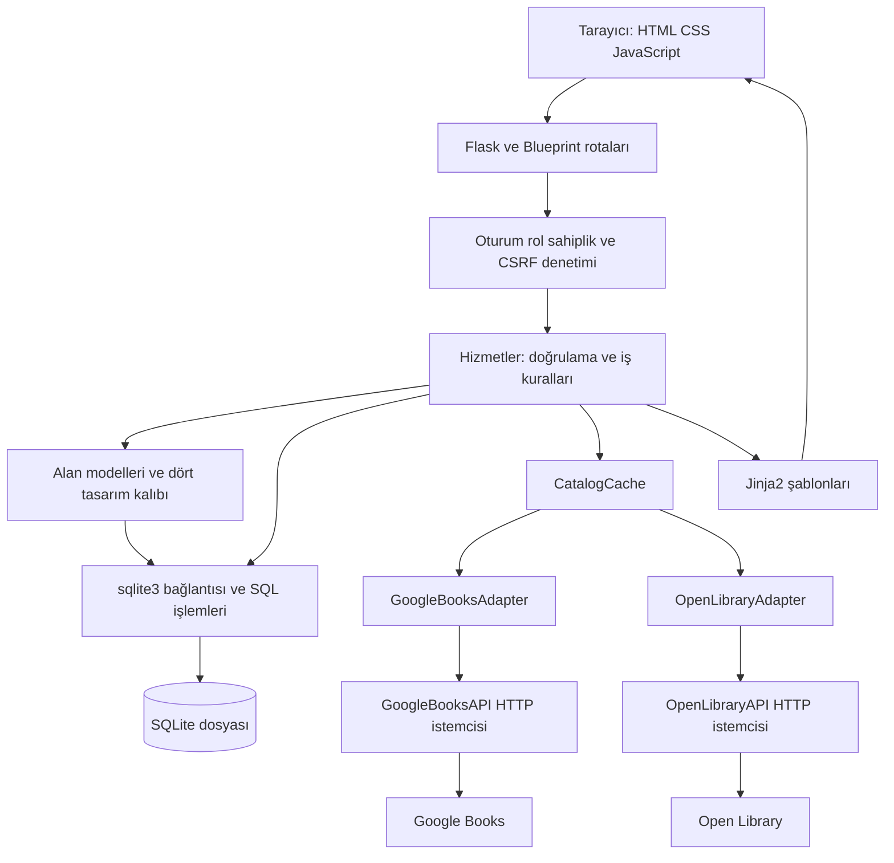
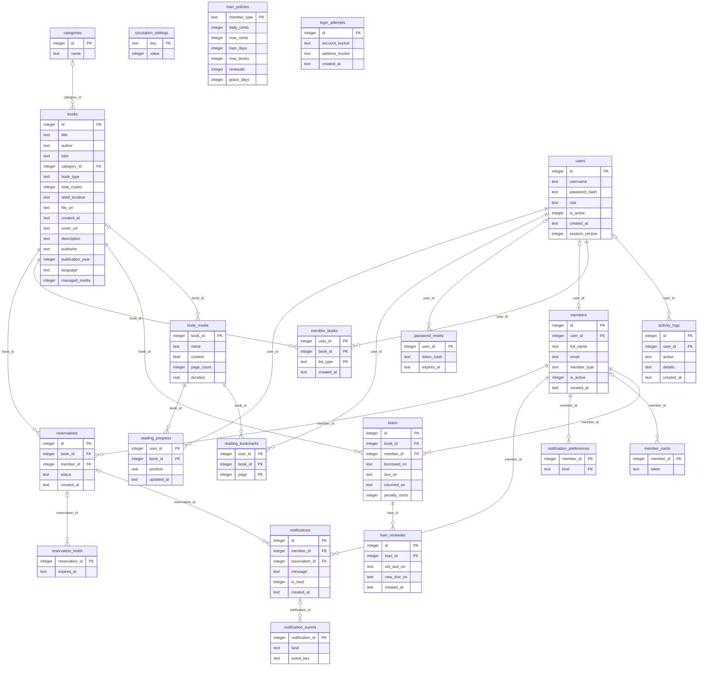
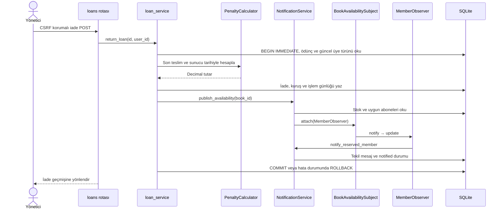

# Sistem Mimarisi

**Ders:** EBLG443 — Tasarım Kalıpları

**Proje:** Kütüphane Yönetim Sistemi V2.0 · Aşama 23

## V2 bileşenleri

Flask Blueprint’leri rol denetimli HTML ve dosya sunumunu yapar. Kitap, üye, dijital medya, dolaşım, analitik, rapor ve sistem hizmetleri ayrı modüllerdedir. SQLite, dosya BLOB’ları dahil kalıcı durumu saklar. Jinja ve yerel JavaScript, okuyucu, kamera, tema ve gezinme denetimlerini sunar.

| Akış | Uygulama sınırı |
| --- | --- |
| Kitap üretme | BookCreator, PhysicalBookCreator, EBookCreator, AudioBookCreator ve tür doğrulamaları |
| Harici arama | BookDataProvider, iki HTTP istemcisi ve adaptörü, sınırlı önbellek |
| Dijital erişim | Dijital hizmet, etkin ödünç denetimi, kişisel konum ve ayraç kayıtları |
| Ödünç ve iade | LoanService, PenaltyCalculator, yapılandırılabilir Strategy, Observer ve SQLite işlemi |
| Zamanlanmış bakım | refresh-circulation komutu, süreli ayırma ve yinelenmeyen bildirim olayları |
| Analitik ve dışa aktarma | SQLite sorguları, Jinja grafik tabloları, PDF, XLSX ve CSV üreticileri |
| Güvenlik ve bakım | Oturum sürümü, giriş sınırı, tek kullanımlık kodlar, günlük ve doğrulanmış yedek |

Şema geçişi mevcut kitap kimliklerini ve ilişkileri korur. Yeni tablolar dijital medya ve kullanıcı konumunu, kişisel listeleri, opak kart kimliklerini, dolaşım politikalarını, süreli ayırmayı, bildirim olaylarını ve hesap güvenliği durumunu saklar. [Güvenlik ve geri yükleme](GUVENLIK.md)

## 1. Mimari yaklaşım

Uygulama, tek Flask sürecinde çalışan ve SQLite dosyasını kullanan katmanlı bir web sistemidir. `create_app(test_config=None)` uygulama fabrikası yapılandırmayı yükler, Blueprint modüllerini ve güvenlik/hata işleyicilerini kaydeder. Bu fabrika, Factory Method kalıbındaki BookCreator ile aynı kavram değildir: biri Flask kurulum işlevi, diğeri kitap ürünü oluşturan kalıtım tabanlı tasarım kalıbıdır.

ORM, ayrı REST API, görev kuyruğu, mikroservis veya istemci tarafı SPA katmanı yoktur. Rotalar HTML yanıtları ve form yönlendirmeleri üretir; iş kuralları hizmetlere ayrılmıştır.

## 2. Ön yüz mimarisi

`templates/base.html` ortak gezinme, profil, bildirim rozeti, hata/başarı mesajları ve onay penceresini sağlar. Diğer şablonlar Jinja kalıtımıyla bu kabuğu genişletir. Menüdeki **Genel Bakış**, `/panel` yoludur; `/` yalnız tanıtımdır. Yöneticiye ait kontroller koşullu görünür; gerçek yetkilendirme yine sunucudadır.

`static/css/style.css`, lacivert, beyaz, gri ve turkuaz paletini, açık/koyu temaları ve duyarlı yerleşimi içerir. Tablolar dar alanda yatay kaydırılabilir. `theme.js` ilk görünümde tercihi okur; `ui.js` tema/yoğunluk, mobil menü, Escape/Tab davranışı, onay ve grafik açıklamalarını yönetir. `books.js` türe göre raf/dosya alanlarını etkinleştirir. JavaScript kapalıyken formlar ve temel gezinme sunucu üzerinden çalışır; görünüm tercihlerini değiştirmek JavaScript gerektirir. Tercihler `localStorage` içinde tarayıcıya özeldir, SQLite'a yazılmaz.

Grafikler SQLite sorgularının Jinja ile SVG'ye dönüştürülmesidir; uzak grafik kütüphanesi yoktur. Altı aylık hareketler takvim ayına göre sayılır; gelecek tarihli kayıtlar grafiğe eklenmez. Koleksiyon dağılımı kitap kaydı sayısını gösterir, kopya toplamını değil.

## 3. Arka uç modülleri ve sorumlulukları

| Modül | Sorumluluk |
| --- | --- |
| app.py | Uygulama fabrikası, kayıtlar, hata sayfaları, güvenlik başlıkları |
| config.py | .env, SQLite yolu, oturum ve istek boyutu ayarları |
| database.py | İstek kapsamlı bağlantı, kapanış, tr_fold, kurulum ve kontrol CLI'si |
| security.py | CSRF, login_required, role_required ve pozitif SQLite kimliği |
| models/ | Değiştirilemez dataclass modelleri ve RowModel.from_row; SQL yazmaz |
| models/isbn.py, models/urls.py | ISBN kontrol basamağı/eşdeğerliği ve güvenli URL doğrulaması |
| patterns/ | Oluşturucu, veri sağlayıcı, ceza algoritması ve gözlemci sözleşmeleri |
| routes/auth.py | Giriş/çıkış, her istekte güncel kullanıcı ve oturum sürümü |
| routes/books.py, google_books.py | Katalog CRUD ve dış arama/önizleme |
| routes/members.py | Yönetici üye dizini, hesap bağlantısı, durum ve geçmiş |
| routes/loans.py | Ödünç, iade, kişisel liste ve veri yazmayan simülatör |
| routes/reservations.py, notifications.py | Rezervasyon sahipliği ve kişisel bildirimler |
| routes/dashboard.py, settings.py | Gerçek panel, hesap/rol sayfası, tarayıcı ayarları |
| routes/design_patterns.py | Gerçek sınıf kodları ve açıkça etiketli eğitim gösterimleri |
| services/auth_service.py | Werkzeug doğrulama, aktiflik, oturum iptali |
| services/book_service.py | Factory seçimi, ISBN tekrarı, kitap SQL işlemleri |
| services/member_service.py | Alan doğrulama, isteğe bağlı hesap, aktiflik işlemleri |
| services/loan_service.py | Türkiye takvim günü, stok/sıra, Strategy ve atomik iade |
| services/reservation_service.py | FIFO uygun üye kuyruğu, kayıt/iptal |
| services/notification_service.py | Aboneleri yükleme, Observer yayını, tekillik, kişisel okuma |
| services/dashboard_service.py | Role göre filtreli gerçek istatistikler ve etkinlikler |
| services/google_books_api.py, open_library_api.py | Sabit dış URL, HTTP zaman aşımı ve hata çevirisi |
| services/catalog_cache.py | Sonuç ve ayrıntı önbelleği, sağlayıcıya özel kota beklemesi |
| services/validation.py | Kimlik aralığı, sayfalama ve LIKE kaçışı |
| seed.py, services/demo_accounts.py | Yalnız açık komutla yerel gösterim hazırlama |

Veri nesneleri SQL satırlarının tipli temsilidir; tüm ortak alan doğrulamaları modellerde değildir. Form kuralları hizmetlerde, ürüne özgü kurallar Book alt sınıflarında, ilişkisel kurallar SQL'dedir.

## 4. Veritabanı mimarisi ve ER diyagramı

Sekiz tablo bulunur. Aşağıdaki diyagram `schema.sql` bellekte uygulanarak `PRAGMA table_info` ve `foreign_key_list` üzerinden üretilir. `PK`, birincil anahtar; `FK`, yabancı anahtardır. `user_id` bağlantısı olmayan üye fiziksel dolaşıma katılabilir, fakat kişisel oturum açamaz. Bir kullanıcının en fazla bir üye kaydı vardır. Bildirimin rezervasyon bağlantısı isteğe bağlıdır; gösterim bildirimi bu bağlantıyı taşımayabilir.

<!-- SOURCE:er -->

<!-- END:er -->

[Mermaid kaynağı](diagrams/er.mmd). `books.category_id`, `members.user_id`, `notifications.reservation_id` ve `activity_logs.user_id` nullable'dır. Yabancı anahtarların silme davranışı RESTRICT'tir; geçmiş verisini korur.

### Bütünlük ve işlem sınırları

- `book_inventory` görünümü: kullanılabilir adet = toplam adet − iade edilmemiş ödünç sayısı. Ayrı stok sayacı tutulmaz. E-kitapta adet eşzamanlı lisans sayısıdır.
- `one_active_loan`: aynı kitap/üyede bir aktif ödünç. `one_active_reservation`: active/notified durumlarında tek rezervasyon.
- `one_reservation_notification`: rezervasyon başına bir bildirim; sorgu denetimi ve benzersiz indeks birlikte kullanılır.
- Tarihler ISO biçiminde TEXT, para negatif olmayan tamsayı kuruş olarak saklanır. Hesaplama `Decimal` ile yapılır.
- Tetikleyiciler stok sınırını, pasif üyeye ödünç/rezervasyon yasağını, ödünç kimliği/geçmişini ve rezervasyon durum geçişlerini korur.
- Hizmet yazmaları `BEGIN IMMEDIATE` ve `with db` kullanır. Hata halinde bütün yazmalar geri alınır. Bildirim hizmeti dış işlemi kullanır; kendi commit etmez.
- Bağlantı Flask `g` içinde istek başına ihtiyaç halinde açılır; foreign_keys etkinleştirilir, timeout 10 saniyedir; teardown bağlantıyı kapatır.

SQL tetikleyicileri bütün uygulama kurallarını tek başına uygulamaz; örneğin ISBN eşdeğerliği, rezervasyon sırası ve bağlı hesabın aktifliği hizmet katmanında denetlenir. Uygulama başlatılması şemayı veya gösterim verisini otomatik oluşturmaz; CLI gerekir.

Rezervasyon geçişleri: `active → notified/cancelled/fulfilled`, `notified → cancelled/fulfilled`. İptal ve tamamlanma son durumlardır. Kuyruk `created_at, id` sırasındadır; pasif üyeler/hesaplar uygun kuyruktan çıkarılır.

## 5. Veri akışları

### Kitap kaydı ve dış veri

Form → rol/CSRF → book_service.prepare_book → somut BookCreator.prepare_book → create_book → ürün doğrulaması → ISBN/stok/geçmiş kuralları → kitap ve etkinlik kaydı → commit → yönlendirme.

Harici arama seçilen adaptöre, HTTP istemcisine ve sağlayıcıya gider. İki adaptör de dış JSON yanıtını BookImportData biçimine dönüştürür. Düzenlenebilir taslak, mevcut Factory Method kayıt akışında kullanılır. Arama hatasında diğer kaynak denenir. Üye ve yönetici Kitap Keşfet sayfasından arayabilir ve ayrıntıları görebilir. Yönetici taslağı düzenleyip kaydedebilir. API anahtarı sunucuda kalır ve kapak adresleri sağlayıcı alan adlarıyla sınırlandırılır. [Harici katalog kılavuzu](ADAPTER.md)

### İade, Strategy ve Observer

İade tarihi istemciden alınmaz; UTC+3 sunucu takvim günü kullanılır. İadede üyenin o andaki türü esas alınır; daha sonra tür değişse de kaydedilmiş kesin ceza değişmez. Bildirim bütün uygun bekleyenlere bilgi verebilir; aynı kitabı hepsine ayırmaz. Yeni ödünçte mevcut stok ve sıranın ilk uygun üyesi yeniden denetlenir.

### Panelin gerçek anlamı

Yönetici toplam kitap kaydı, en az bir kullanılabilir kopyası olan kayıt, tüm üye sayısı, aktif/geciken ödünç ve bekleyen rezervasyonları görür. Üye kendi ödünç, rezervasyon, etkinlik ve bildirim sayılarını görür. Koleksiyon tür dağılımı her iki rolde genel katalog kapsamındadır. Yönetici son yedi etkinliği, üye kendi son yedi ödünç/iade olayını görür; geciken liste ilk beş kayıttır.

## 6. Güvenlik mimarisi

Parolalar Werkzeug `generate_password_hash` ile tuzlu özetlenir, `check_password_hash` ile doğrulanır. Bozuk hash genel giriş reddi üretir; bulunmayan kullanıcıda sahte hash kontrolü yapılır. Parola veya ham hash arayüzde gösterilmez.

Flask oturumu imzalı istemci çerezidir; şifreli veri kasası değildir. Çerez kullanıcı kimliği ve oturum sürümünü taşır; rol her istekte SQL'den okunur. HttpOnly, SameSite=Lax, 30 dakikalık sabit süre ve istekle otomatik uzatmama ayarlanmıştır. Çıkış `users.session_version` artırarak aynı kullanıcının bütün mevcut oturumlarını iptal eder. Üye pasifleştirme de sürümü artırır; yeniden etkinleştirme eski çerezi canlandırmaz.

Tüm değişiklik yöntemleri POST/PUT/PATCH/DELETE için oturuma bağlı CSRF jetonu gerekir; gizli form alanı veya X-CSRF-Token başlığı kabul edilir. Rol dekoratörlerine ek olarak üyeye özel sorgularda oturumdan bulunan member_id kullanılır; istemcinin gönderdiği üye kimliği yetki vermez. Başkasının bildirim/rezervasyon kimliği 404 üretir.

SQL girdileri parametrelenir; dinamik SQL parçaları uygulamanın sabit listelerinden gelir. LIKE jokerleri kaçırılır. Jinja otomatik HTML kaçışı, yerel betikler ve CSP, kaydedilmiş/yansıtılmış XSS riskini sınırlar. X-Frame-Options=DENY, nosniff, same-origin referrer ve HTML no-store başlıkları eklenir. İstek gövdesi 1 MiB ile sınırlıdır. Kimlikler pozitif SQLite INTEGER aralığında doğrulanır.

403 rol reddi, 400 CSRF/girdi, 422 alan kuralı, 409 iş çatışması ve 503 SQLite erişim hatası Türkçe sayfalarda işlenir. Google arama hataları 502/503 ile gösterilebilir. Hata ayrıntıları/anahtarlar kullanıcıya dökülmez. HTTPS, hız sınırlama, MFA, çevrimiçi CVE denetimi ve genel yayın sertifikasyonu uygulanmış kabul edilmez.

## 7. Rotalar ve izlenebilirlik

Aşağıdaki envanter `create_app().url_map` üzerinden üretilir; HEAD/OPTIONS listeden çıkarılır. Yetki ayrıntıları üstteki modüller ve [kullanım kılavuzundadır](KULLANIM_KILAVUZU.md).

<!-- SOURCE:routes -->

| Yol | Yöntemler | Endpoint |
| --- | --- | --- |
| / | GET | index |
| /analitik | GET | analytics.index |
| /ayarlar | GET | settings.index |
| /ayarlar/odunc-politikasi | GET, POST | settings.circulation |
| /ayarlar/parola | GET, POST | member_portal.password |
| /ayarlar/yedek | GET | system.backup |
| /bildirimler | GET | notifications.index |
| /bildirimler/&lt;int:notification_id&gt;/oku | POST | notifications.read |
| /bildirimler/tercihler | POST | notifications.preferences |
| /bildirimler/tumunu-oku | POST | notifications.read_all |
| /cezalar | GET | member_portal.penalties |
| /cikis | POST | auth.logout |
| /dijital-kutuphane | GET | digital.index |
| /dijital-kutuphane/&lt;int:book_id&gt;/ayrac | POST | digital.bookmark |
| /dijital-kutuphane/&lt;int:book_id&gt;/ilerleme | POST | digital.progress |
| /dijital-kutuphane/&lt;int:book_id&gt;/oku | GET | digital.reader |
| /dijital-kutuphane/&lt;int:book_id&gt;/sayfa/&lt;int:page&gt; | GET | digital.page_image |
| /dijital-kutuphane/&lt;int:book_id&gt;/ses | GET | digital.audio |
| /favorilerim | GET | member_portal.shelf |
| /giris | GET, POST | auth.login |
| /hesabim | GET | dashboard.account |
| /islem-gecmisi | GET | system.audit |
| /kategoriler | GET, POST | categories.index |
| /kitap-kesfet | GET, POST | google_books.discover |
| /kitap-kesfet/ayrinti | POST | google_books.detail |
| /kitaplar | GET | books.index |
| /kitaplar/&lt;int:book_id&gt;/duzenle | GET, POST | books.edit |
| /kitaplar/&lt;int:book_id&gt;/sil | GET, POST | books.delete |
| /kitaplar/ekle | GET, POST | books.add |
| /kitaplar/google | GET, POST | google_books.search |
| /kitaplar/google/aktar | POST | google_books.preview |
| /kitaplarim | GET | member_portal.my_books |
| /kitaplarim/&lt;int:book_id&gt;/liste | POST | member_portal.list_action |
| /odunc | GET | loans.index |
| /odunc/&lt;int:loan_id&gt;/iade | GET, POST | loans.return_book |
| /odunc/&lt;int:loan_id&gt;/yenile | POST | loans.renew |
| /odunc/simulator | GET, POST | loans.simulator |
| /odunc/ver | GET, POST | loans.borrow |
| /okuma-gecmisim | GET | member_portal.history |
| /okuma-listem | GET | member_portal.shelf |
| /panel | GET | dashboard.panel |
| /parola-sifirla | GET, POST | auth.reset |
| /profilim | GET, POST | member_portal.profile |
| /raporlar | GET | reports.index |
| /rezervasyonlar | GET | reservations.index |
| /rezervasyonlar/&lt;int:reservation_id&gt;/iptal | POST | reservations.cancel |
| /rezervasyonlar/ekle | GET, POST | reservations.add |
| /static/&lt;path:filename&gt; | GET | static |
| /tasarim-kaliplari | GET | design_patterns.index |
| /tasarim-kaliplari/&lt;pattern_id&gt;/dene | POST | design_patterns.demo |
| /uye-kartim | GET | member_cards.card |
| /uye-kartim/indir/&lt;file_format&gt; | GET | member_cards.download |
| /uye-kartim/qr | GET | member_cards.qr |
| /uye-tani | GET, POST | member_cards.scan |
| /uyeler | GET | members.index |
| /uyeler/&lt;int:member_id&gt; | GET | members.history |
| /uyeler/&lt;int:member_id&gt;/durum | POST | members.status |
| /uyeler/&lt;int:member_id&gt;/duzenle | GET, POST | members.edit |
| /uyeler/ekle | GET, POST | members.add |
| /yonetim | GET | dashboard.admin |

<!-- END:routes -->

Kaynaklar: [uygulama](../app.py), [şema](../schema.sql), [güvenlik](../security.py), [testler](TEST.md). Teknik belge aşaması tamamlanmıştır; güncel yerel yayın hazırlığı [GitHub raporunda](GITHUB_YAYINLAMA.md) açıklanır.
