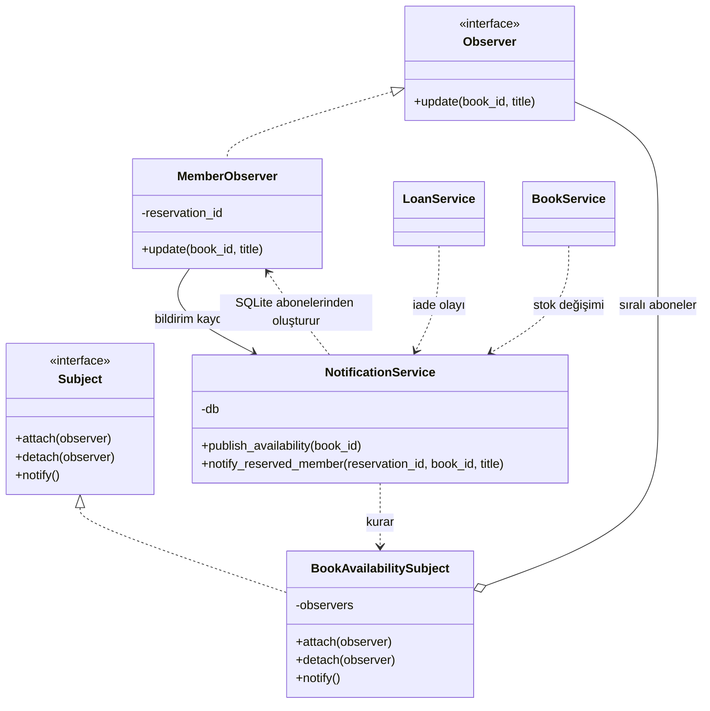

# Observer — Rezervasyon ve bildirimler (Aşama 7)

## Tanım, problem ve çözüm

Observer, bir konunun değişimini kendisine abone olan nesnelere ortak arayüzle
iletmesini sağlar. Ödünç hizmetinin her rezervasyon sahibinin bildirim ayrıntısını
bilmesi, iade ve iletişim sorumluluklarını birbirine bağlar.

`BookAvailabilitySubject` kullanılabilirlik olayını yayınlar. `MemberObserver`
olayı alır ve `NotificationService` üzerinden SQLite'a bildirim yazdırır.
Aboneliklerin kalıcı kaynağı aktif rezervasyonlardır; Python nesneleri her olayda
veritabanından yeniden yüklenir. Böylece sunucu yeniden başlasa da abonelik kaybolmaz.

## Roller ve gerçek uygulama

| Sınıf | Kalıptaki rol | Dosya |
| --- | --- | --- |
| Observer | Soyut `update(book_id, title)` sözleşmesi | patterns/observer.py |
| Subject | Soyut attach/detach/notify sözleşmesi | patterns/observer.py |
| BookAvailabilitySubject | Konu ve abonelerin sıralı yayın listesi | patterns/observer.py |
| MemberObserver | Bir rezervasyona bağlı somut gözlemci | patterns/observer.py |
| NotificationService | SQLite abonelerini yükler, konuyu kurar, bildirimleri kaydeder | services/notification_service.py |

`attach()` aynı gözlemci nesnesini ikinci kez eklemez. `detach()` kayıtlı gözlemciyi
çıkarır; bulunmayan gözlemciyi çıkarmak güvenlidir. `notify()` o anki abone listesinin
kopyası üzerinde dolaşıp `update()` çağırır. Bir gözlemci hata verirse hata yutulmaz;
çağıranın SQLite işlemi geri alınır.

Rezervasyon iptali kalıcı aboneliği sonlandırır. Kalıcı, uzun ömürlü bir Python konu
nesnesi tutulmadığından iptalde bütün sunucularda `detach()` çağırmak gerekmez;
sonraki yayın iptal edilen rezervasyonu yüklemez. `detach()` davranışı birim testinde
ayrıca doğrulanır. Abone sırası `(created_at, id)` ile kararlıdır.

## Kullanıcı akışı ve yetkiler

- `/rezervasyonlar`: yönetici tüm rezervasyonları, üye yalnızca kendininkileri görür.
- `/rezervasyonlar/ekle`: yalnızca mevcut olmayan kitap için rezervasyon oluşturur.
  Yönetici aktif üyeyi seçer; üye formda başka kimlik gönderse bile kendi adına işlem yapar.
- `/rezervasyonlar/ID/iptal`: CSRF korumalı POST; yönetici veya rezervasyon sahibi iptal edebilir.
- `/bildirimler`: her kullanıcı yalnızca kendi üyeliğine bağlı bildirimleri görür.
  Yönetici rolü başkalarının özel bildirimlerine erişim sağlamaz.
- `/bildirimler/ID/oku`: CSRF korumalı POST; sahip olmayan kullanıcıya 404 döner.
  Okunmuş bildirimi tekrar işaretlemek zararsızdır.
- Menüde yalnızca oturum sahibinin okunmamış bildirim sayısı gösterilir.

Kitaplar sayfasında mevcut olmayan kayıtta **Rezerve et** bağlantısı da bulunur.
İptal ve okuma GET ile yapılmaz. Eksik üyelik profiliyle rezervasyon oluşturma 403 döndürür.
Kişisel bildirim veya rezervasyon için `member_id` sorgu parametresi erişimi genişletmez.
Listeler 20 kayıtlık sayfalara ayrılır.

## Rezervasyon ve kuyruk kuralları

Kitabın mevcut adedi 0 olmalıdır. Üye ve bağlı kullanıcı hesabı aktif olmalıdır.
Aynı üye/kitap için `active` veya `notified` durumda ikinci rezervasyon oluşturulamaz.
Üyenin elindeki aynı kitaba rezervasyon oluşturulması da reddedilir.

Durumlar:

```text
active   → notified / cancelled / fulfilled
notified → cancelled / fulfilled
```

`notified` rezervasyon hâlâ bekleme sırasındadır. Sıra oluşturulma zamanına, eşit
zamanda kayıt numarasına göre belirlenir. Pasif üyeler/hesaplar işlem önceliği ve
bildirim yayınında atlanır; kayıtları silinmez.

Stok oluştuğunda aktif sıranın ilk uygun üyesine ödünç verilebilir. Başkasına
verilmeye çalışılırsa işlem reddedilir. Ödünç kaydı ve rezervasyonun `fulfilled`
durumuna geçişi aynı işlemde yapılır. Ön sıradaki iptal olursa sıradaki üye ilerler.
Birden çok kopyada da her başarılı ödünçten sonra sıradaki üye işlenir.

## Bildirim politikası ve çift bildirim koruması

Bir kitap mevcut olduğunda o kitaba ait bütün uygun bekleyen abonelere sırayla
bilgi verilir. Mesaj açıkça kitabın ayrılmadığını; ödüncün güncel stok ve kronolojik
sıraya bağlı olduğunu söyler. Bütün alıcıların aynı anda ödünç alabileceği söylenmez.

Her **rezervasyona en fazla bir kullanılabilirlik bildirimi** yazılır.
`NotificationService`, önceden var olan kaydı kontrol eder; SQLite'taki kısmi
`UNIQUE(reservation_id)` indeksi ikinci savunmadır. Bu politika, aynı rezervasyon
için gelecekteki her stok dalgasında tekrar mesaj göndermeyi kapsamaz.
İptal sonrası yeni bir rezervasyon yeni kimlik ve ayrı aboneliktir.
Gösterim bildirimi gibi rezervasyonsuz mesajlar `reservation_id=NULL` kullanabilir.

Okunma bilgisi rezervasyon durumunu değiştirmez. İptal edilen veya ödünçle tamamlanan
rezervasyonun eski bildirimi kişisel geçmişte korunur.

## Atomik olay akışı

1. `return_loan()` `BEGIN IMMEDIATE` ile işlemi başlatır.
2. Çift iade kontrolünden sonra Strategy ile kesin ceza ve iade tarihi yazılır.
3. Stok mevcut `book_inventory` görünümünden doğru hesaplanır.
4. `NotificationService.publish_availability(book_id)` aynı bağlantı/işlem içinde çağrılır.
5. Servis rezervasyonları SQLite'tan yükler ve `MemberObserver` nesnelerini konuya ekler.
6. Konu `notify()` ile her gözlemcinin `update()` metodunu çağırır.
7. Bildirim ve `notified` durum geçişi yazılır; bütün adımlar birlikte commit edilir.

Bildirim yazımı başarısızsa iade, ceza, stok etkisi, işlem günlüğü ve diğer abonelere
yazılan kısmi bildirimler birlikte geri alınır. Bildirim servisi kendi başına commit
etmez; açık işlem olmadan yayın yapılmasını reddeder.

Kitap toplam adedi düzenlenip stok arttığında da aynı yayın yolu kullanılır.
Rezervasyon iptali sonrası hâlâ stok varsa uygun kalan aboneler yine kontrol edilir.
Tekrar yayın veya eşzamanlı yayın ikinci bildirim oluşturmaz. Ödünç, iade, rezervasyon
ve iptal yazmaları aynı SQLite kilitleme yaklaşımını kullanır.

## UML sınıf diyagramı



Bağımsız kaynak: [observer.mmd](diagrams/observer.mmd).

## Kod örneği

Gerçek yayın yolu `services/notification_service.py` içindedir:

```python
subject = BookAvailabilitySubject(book_id, book['title'])
for row in rows:  # SQLite sorgusu: ORDER BY r.created_at, r.id
    subject.attach(MemberObserver(row['id'], self))
return subject.notify()
```

`MemberObserver.update()` servis çağrısına devreder. Konu üyelik, SQL veya mesaj
ayrıntısını bilmez; yalnızca `Observer` arayüzüne bağımlıdır.

## Kurulum / mevcut veritabanını güncelleme

Yeni tablo veya sütun yoktur. Üç indeks `schema.sql` içine eklendi:
rezervasyon başına tek bildirim, kuyruk sırası ve okunmamış mesaj sorgusu.
Mevcut kayıtları silmeden aşağıdaki komutu bir kez çalıştırın:

```powershell
.\.venv\Scripts\python.exe -m flask --app app:create_app init-db
.\.venv\Scripts\python.exe -m flask --app app:create_app check-db
```

Yerel kurulum güncellenmeden önce `instance/library.pre-observer-<zaman>.sqlite3`
adıyla SQLite backup API kullanılarak yedek alındı. Sekiz tablonun kayıt sayıları
güncellemeden önce/sonra eşit doğrulandı. Gösterim verileri yeniden yüklenmedi.
Başka bir veritabanında daha önce aynı rezervasyona bağlı yinelenen bildirim varsa
UNIQUE indeksi kurulamaz; komut veri silerek düzeltmez. Böyle bir durumda yedek
üzerinden kayıtlar incelenip ayrı veri düzeltme kararı verilmelidir.

Sunucuyu yeniden başlatın:

```powershell
.\.venv\Scripts\python.exe -m flask --app app:create_app run
.\.venv\Scripts\python.exe -m pytest tests/test_observer.py tests/test_reservations.py -q
.\.venv\Scripts\python.exe -m pytest -q
```

## Elle kontrol

1. Yöneticiyle mevcut olmayan bir kitabı iki farklı aktif üye için rezerve edin.
2. Rezervasyonlarda kronolojik sırayı kontrol edin.
3. İlgili kitabın aktif ödüncünü iade alın.
4. İlgili üye hesabıyla Bildirimler sayfasını ve menü sayacını kontrol edin.
5. Mesajı okundu işaretleyin; sayaç azalmalı, başka üyenin mesajı görünmemelidir.
6. Aynı olayı tekrar işlemek veya çift iade ikinci mesaj üretmemelidir.
7. Ön sıradaki rezervasyonu iptal edin; diğer üyenin sırası ilerlemelidir.
8. Sıradaki üyeye ödünç verildiğinde rezervasyon geçmişte Ödünç verildi görünmelidir.

Yerel gösterim kümesindeki öğretmen üye kaydının başlangıçta kullanıcı hesabı yoktur;
bu üyeye ait mesajlar veritabanında saklanır, başka hesabın Bildirimler sayfasında
gösterilmez. Otomatik testler bu üyeye yalnızca geçici test veritabanında bir hesap
bağlayarak kişisel görüntüleme ve izinleri sınar. Yerel kullanıcı hesapları değiştirilmez.

Mevcut iki yerel hesapla mesajı elle görmek için yönetici iki e-kitap lisansını
öğretmen ve normal üyeye ödünç verebilir; öğrenci e-kitabı rezerve eder. Yönetici bu
e-kitap ödünçlerinden birini iade aldığında öğrenci kendi hesabında bildirimi görür.
Bu senaryo elle deneme önerisidir; yerel veritabanında otomatik uygulanmamıştır.

## Avantajlar ve sınırlar

Konu ile aboneler gevşek bağlıdır; yeni gözlemci `Observer` arayüzüyle eklenebilir.
İade hizmeti kişi başına mesaj mantığını bilmez. Tek sorumluluk, bileşim ve çok
biçimlilik korunur. SQLite abonelik kaynağı sunucu yeniden başlatmalarına dayanır.

Senkron yayın işlem süresini uzatır ve gözlemci hatası bütün işlemi geri alır.
Bu seçim küçük, yerel ders projesinde tutarlılığı basit tutar. E-posta/SMS,
arka plan iş kuyruğu, stok kilitleme, rezervasyon süresi dolumu ve periyodik tekrar
bildirim bu aşamada yoktur. Bildirim yalnızca uygulama içinde saklanır.

Gerçek test sonuçları [TEST.md](TEST.md) belgesindedir. Bu belge yedinci aşamanın ayrıntılarını korur; güncel bütünleşik inceleme [Tasarım Kalıpları](TASARIM_KALIPLARI.md) içindedir.
