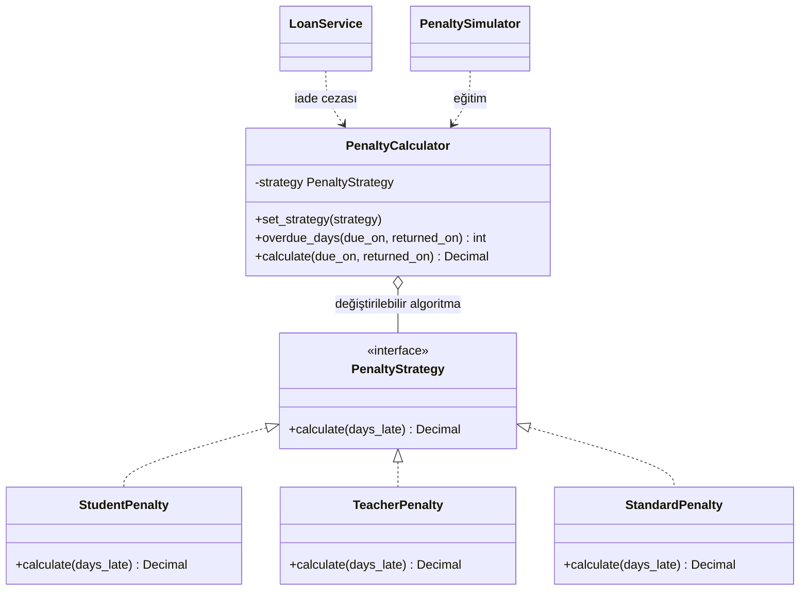

# Strategy — Gecikme cezası ve ödünç yönetimi (Aşama 6)

## Tanım, problem ve çözüm

Strategy, aynı işlemin farklı algoritmalarını ortak bir arayüz arkasında toplar.
Bağlam, somut algoritmayı bilmeden ona işi devreder; strateji çalışma sırasında değiştirilebilir.
Kütüphanede üyelik türleri farklı günlük ücret gerektirir. Tek bir hesaplayıcıya
çok sayıda koşul eklemek yerine `PenaltyStrategy` arayüzü kullanılır.

## Sınıflar

| Sınıf | Görev | Günlük ücret |
| --- | --- | --- |
| PenaltyStrategy | Soyut `calculate(days_late)` sözleşmesi | — |
| StudentPenalty | Öğrenci algoritması | 2 TL |
| TeacherPenalty | Öğretmen algoritması | 1 TL |
| StandardPenalty | Normal üye algoritması | 5 TL |
| PenaltyCalculator | Stratejiyi içerir, gün hesabı yapar ve algoritmaya devreder | — |

Tam kod `patterns/strategy.py` içindedir. Para `Decimal` olarak TL cinsinden
hesaplanır; `loans.penalty_cents` alanına tamsayı kuruş yazılır. Kayan noktalı
para hesabı yapılmaz. Şema değişikliği veya yeni bağımlılık gerekmez.

## Tarih ve ücret kuralları

Gecikme günü = `max(0, (iade_tarihi - son_teslim_tarihi).days)`.
Son teslim gününde veya önce iade cezasızdır. Hesap takvim gününü kullanır;
saatlik ücret, hafta sonu indirimi ve tatil istisnası yoktur.

Gerçek ödünç/iade tarihi sunucuda Türkiye takvim gününden (UTC+03:00) alınır.
Tarayıcıdan gönderilen iade tarihi, ücret veya üye türü kabul edilmez.
Son teslim tarihi geçerli ISO `YYYY-MM-DD` olmalı ve ödünç tarihinden önce olmamalıdır.
Ödünç tarihi gerçek işlem günüdür; geçmiş tarihli ödünç oluşturma arayüzü yoktur.

İade sırasında üyelik türü güncel `members.member_type` alanından okunur.
Üyelik türü sonradan değişse bile daha önce kaydedilmiş kesin ceza yeniden hesaplanmaz.
Aktif ödünçlerde ekrandaki tutar **bugüne göre tahmin**; iadelerdeki tutar
**veritabanına kaydedilmiş kesin tutar** olarak etiketlenir.

## Dinamik strateji değişimi — gerçek kod örneği

```python
from datetime import date
from patterns.strategy import (
    PenaltyCalculator, StudentPenalty, TeacherPenalty, StandardPenalty,
)

calculator = PenaltyCalculator(StudentPenalty())
due = date(2026, 11, 10)
returned = date(2026, 11, 15)
calculator.calculate(due, returned)  # Decimal('10.00')
calculator.set_strategy(TeacherPenalty())
calculator.calculate(due, returned)  # Decimal('5.00')
calculator.set_strategy(StandardPenalty())
calculator.calculate(due, returned)  # Decimal('25.00')
```

Aynı bağlamın stratejisi değişmiştir. Gün hesabı değişmez; ücret algoritması değişir.
Gerçek iade hizmeti `PENALTY_STRATEGIES` kaydından veritabanındaki üyelik türüne
uygun somut stratejiyi seçer ve `PenaltyCalculator` üzerinden hesaplar.
Testte farklı bir strateji kaydedilerek hizmetin gerçekten bu algoritmayı kullandığı doğrulanır.

## Dosyalar ve sorumluluklar

| Dosya | Sorumluluk |
| --- | --- |
| patterns/strategy.py | Soyut strateji, üç algoritma ve hesaplayıcı |
| services/loan_service.py | Stok/üye denetimi, atomik ödünç/iade, tahmini ceza ve listeleme |
| routes/loans.py | Blueprint, sunucu yetkileri, HTTP form yanıtları ve simülatör |
| templates/loans.html | Aktif ödünçler, geçmiş, gecikme ve ceza görünümü |
| templates/loan_form.html | Yeni ödünç formu |
| templates/loan_return.html | İade onayı ve ceza önizlemesi |
| templates/penalty_simulator.html | Veritabanına yazmayan eğitim aracı |
| tests/test_strategy.py | Algoritma, bağlam değişimi ve tarih birim testleri |
| tests/test_loans.py | İşlem, stok, izin ve HTTP bütünleştirme testleri |

## Yetkiler ve kullanım

Oturum açıp menüden **Ödünç İşlemleri** bağlantısını seçin:
http://127.0.0.1:5000/odunc

| Yol | Yöntem | Erişim |
| --- | --- | --- |
| /odunc | GET | Yönetici tüm kayıtları, üye yalnızca kendi kayıtlarını görür |
| /odunc/ver | GET, POST | Yalnızca Yönetici |
| /odunc/ID/iade | GET, POST | Yalnızca Yönetici; GET kayıt değiştirmez |
| /odunc/simulator | GET, POST | Aktif kullanıcı; veri yazmaz |

Aktif / İade geçmişi / Tümü filtreleri vardır. Liste 20 kayıtlık sayfalara ayrılır.
Gecikmiş aktif kayıtlar metin etiketi ve turuncu zeminle ayrılır; durum yalnızca renkle anlatılmaz.
Üyenin URL'de başka üye kimliği göndermesi erişimi genişletmez. Bütün POST formları
CSRF korumalıdır. Üyenin doğrudan ödünç veya iade adresine erişimi 403 ile reddedilir.

### Ödünç verme

Yönetici aktif üye, mevcut kitap ve son teslim günü seçer. Form yalnızca aktif
üyeleri ve mevcut kitapları listeler; hizmet kaydetmeden önce tekrar kontrol eder.
Pasif kullanıcı hesabına bağlı üye de reddedilir. Üyenin aynı kitap için ikinci aktif
ödüncü oluşturulamaz. Elektronik kitaplarda mevcut lisans adedi kullanılır.

### İade ve işlem bütünlüğü

İade önce onay sayfasında bugünkü ceza ile gösterilir. POST sırasında güncel tarih ve
üyelik türü yeniden okunur; önizleme tutarına güvenilmez.

`BEGIN IMMEDIATE` sonrasında kayıt yüklenir, çift iade kontrol edilir, Strategy ile
ceza hesaplanır, iade tarihi/ceza ve `activity_logs` satırı aynı SQLite işleminde yazılır.
Bir adım başarısız olursa tüm yazmalar geri alınır. Güncelleme ayrıca
`WHERE returned_on IS NULL` koşuluyla korunur. Mevcut SQL tetikleyicileri sürer.

Stok için ayrı sayaç güncellenmez: `book_inventory` görünümü aktif ödünç sayısını
toplam adetten çıkarır. İade kaydı kesinleşince kullanılabilir stok aynı işlemle doğru hale gelir.
İkinci iade stoku tekrar artırmaz. Son kopyaya eşzamanlı iki ödünç isteğinde yalnızca
biri başarılı olur; eşzamanlı iki iade isteğinde de tek kesin kayıt oluşur.

Pasif üyelerin eldeki kitabı iade etmesi engellenmez; yeni ödünç alamazlar.
Rezervasyon sırası ve otomatik Observer bildirimi yedinci aşamada bu akışa
eklenmiştir: [Observer](OBSERVER.md).

## Simülatör

**Ceza simülatörü** düğmesi üç üyelik türü ve iki tarih seçtirir. Gerçek işlemlerdeki
`PenaltyCalculator` ve stratejileri kullanır. Simülatörün seçimi gerçek üyeliği veya
ödünç kaydını değiştirmez; hiçbir tabloya yazmaz. Son teslim gününden erken tarih
seçmek geçerlidir ve 0 TL üretir.

## UML sınıf diyagramı



Bağımsız kaynak: [strategy.mmd](diagrams/strategy.mmd).

## Avantajlar

Algoritma seçimi hesaplama akışından ayrılır. Yeni strateji ortak arayüzle eklenir;
`PenaltyCalculator` değişmez. Bileşim, çok biçimlilik, gevşek bağlılık ve açık-kapalı
ilkesi somut olarak kullanılır. Tarih hesabı ve ücret algoritmaları bağımsız sınanır.

## Dezavantajlar ve sınırlar

Basit üç tarife için daha çok sınıf gerekir. Üyelik türü/strateji eşlemesini istemci
yönetmelidir; yeni üye türünde veri kısıtları ve arayüz de güncellenir. Strategy tek
başına işlem bütünlüğü sağlamaz; bu sorumluluk SQLite hizmetindedir. Ücret tarifesi
sürümleme ve ödeme/tahsilat işlemleri bu ders aşamasında yoktur. Kesin tutar ile
işlem günlüğündeki gün/tür bilgisi saklanır.

## Çalıştırma ve elle test

Yeni paket veya şema komutu gerekmez. Açık sunucuyu `Ctrl+C` ile durdurup yeniden başlatın:

```powershell
.\.venv\Scripts\python.exe -m flask --app app:create_app run
.\.venv\Scripts\python.exe -m pytest tests/test_strategy.py tests/test_loans.py -q
.\.venv\Scripts\python.exe -m pytest -q
```

1. Yöneticiyle giriş yapın ve mevcut bir kitabı aktif üyeye verin.
2. Aktif listede son teslim gününü ve tahmini cezasını kontrol edin.
3. İade onayını açın; GET isteğinin kaydı değiştirmediğini doğrulayın.
4. İadeyi kaydedin; İade geçmişinde kesin tutarı kontrol edin.
5. Aynı kayıt için yeniden iade deneyin; işlem reddedilmelidir.
6. Önceki gösterim kümesindeki gecikmiş kayıt, bugüne göre gerçek tarih farkı gösterir;
   bunun bir gösterim kaydı olduğunu unutmayın.
7. Simülatörde beş gün gecikmeyi üç stratejiyle deneyin: 10 / 5 / 25 TL.
8. Üye hesabında yalnızca kendi geçmişinin göründüğünü ve yönetim işlemlerinin reddini kontrol edin.

Gerçek otomatik test sonuçları [TEST.md](TEST.md) belgesindedir.
Yedinci aşamadaki devamı: [Observer](OBSERVER.md).
