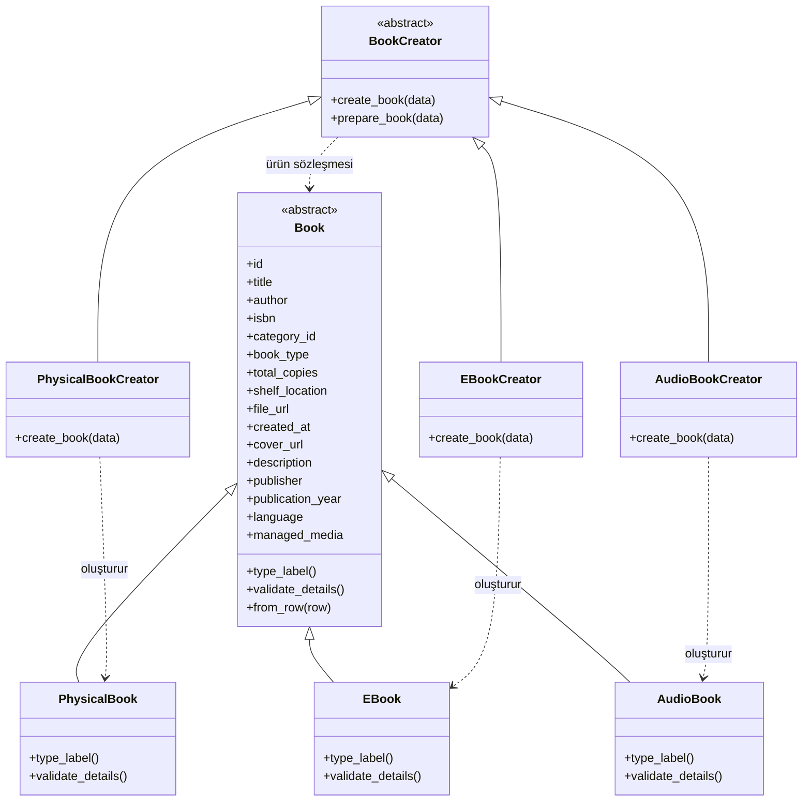
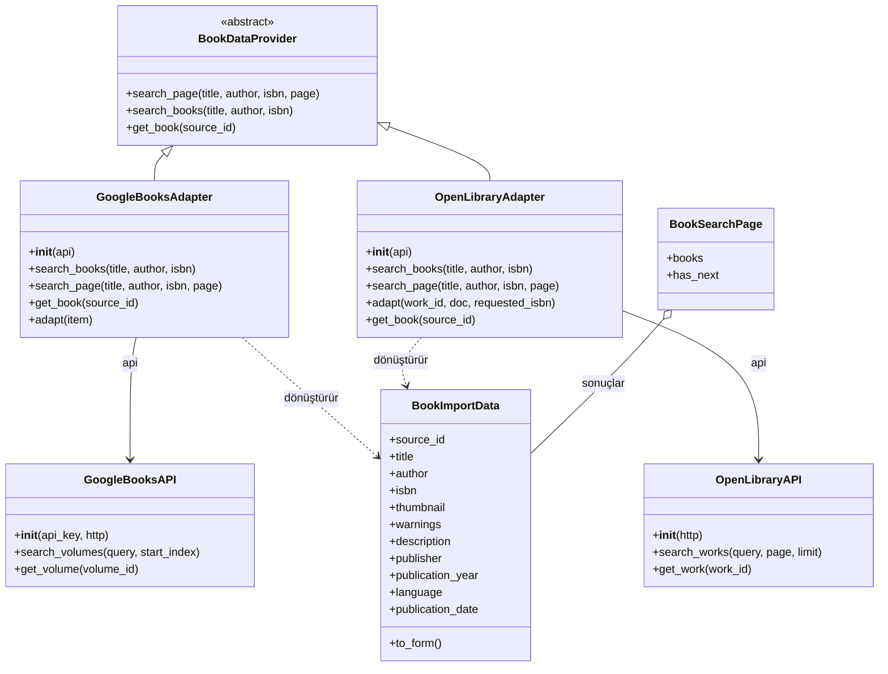
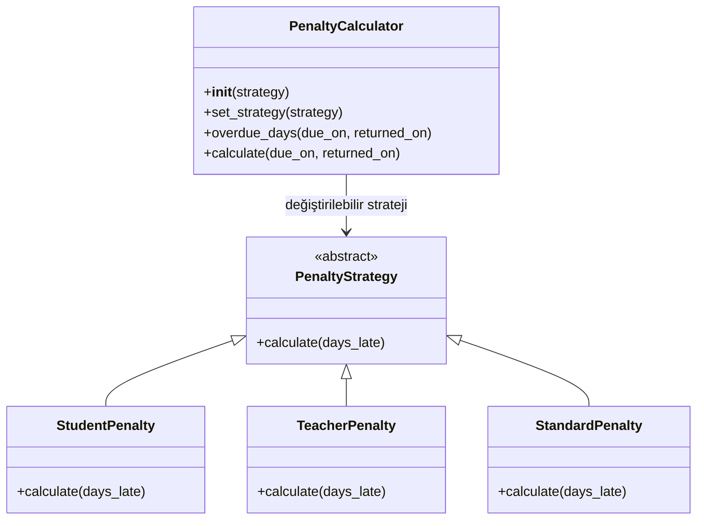
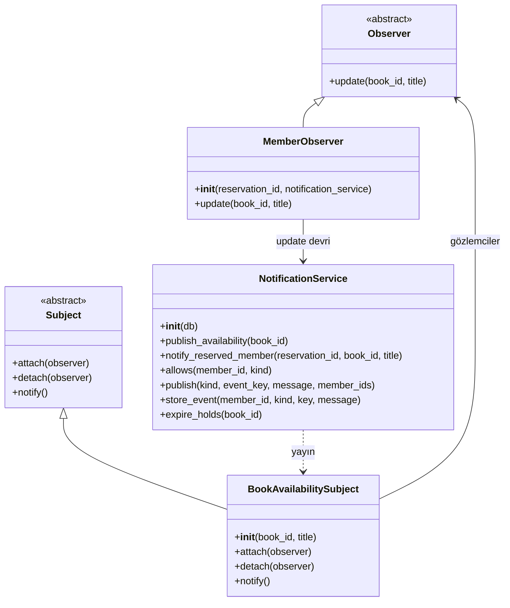

# Tasarım Kalıplarının Akademik İncelemesi

**Ders:** EBLG443 — Tasarım Kalıpları

**Proje:** Kütüphane Yönetim Sistemi · Proje Gelişimi 1

Eğitim paneli üç gerçek kitap oluşturucusunu çalıştırır. Adapter iki farklı sağlayıcı biçimindeki örnek JSON’u ortak modele dönüştürür. Strategy gecikme günü ve üye türü seçimine göre üç stratejiyi karşılaştırır. Observer rezervasyon, gerçek iade hizmeti ve otomatik bildirimi yalıtılmış bellek veritabanında çalıştırır. [Factory Method UML](diagrams/factory_method.mmd) · [Adapter UML](diagrams/adapter.mmd)

## İnceleme yöntemi

Bu belge yalnız mevcut kaynak kodu açıklar. UML sınıfları, kalıtım ve metot adları Python AST'sinden; kod örnekleri aynı dosyaların gerçek kaynak aralıklarından üretilir. Nesne ilişkileri mevcut çağrı/alan bağımlılıklarını gösterir. UML'de `<<abstract>>` soyut sözleşmeyi, açık üçgen kalıtımı, ok kullanım ilişkisini ifade eder. Kalıtılan alanlar alt sınıflarda tekrar listelenmez. Sınıfların iş akışı bağlantıları ayrıca açıklanmıştır.

```powershell
.\.venv\Scripts\python.exe scripts/sync_doc_sources.py
.\.venv\Scripts\python.exe scripts/sync_doc_sources.py --check
```

Mermaid kaynakları [diagrams](diagrams) klasöründedir; GitHub kod bloklarını diyagram olarak işler. Uygulamadaki [SVG diyagramlar](../static/images) ayrı sunum varlıklarıdır. Test sayıları ve sonuçları [TEST.md](TEST.md) içindedir.

## 1. Factory Method

### Tanım, problem ve kullanım amacı

Factory Method, ürün oluşturma sözleşmesini üst sınıfta tanımlayıp somut ürün kararını alt sınıflara bırakan yaratım kalıbıdır. Fiziksel kitap raf konumu, elektronik kitap korunmuş PDF veya geçerli harici adres, sesli kitap doğrulanmış ses dosyası gerektirir. Kitap üretimi, ortak hazırlama akışı ve SQL yazımı ayrı sorumluluklardır.

### Çözüm ve sınıf sorumlulukları

| Sınıf | Kalıptaki rol ve sorumluluk |
| --- | --- |
| Book | Soyut ürün; ortak alanlar, type_label ve validate_details sözleşmesi |
| PhysicalBook | Somut ürün; raf gereksinimini ve dosya alanının boşluğunu doğrular |
| EBook | Somut ürün; güvenli HTTP/HTTPS dosya adresi ve boş raf şartını doğrular |
| BookCreator | Soyut oluşturucu; create_book soyut metodu, prepare_book ortak akışı |
| PhysicalBookCreator | create_book metodunu PhysicalBook üretecek biçimde uygular |
| AudioBook / AudioBookCreator | Sesli kitabı oluşturur ve uygulama içi ses kaynağını gerektirir |
| EBookCreator | create_book metodunu EBook üretecek biçimde uygular |

`BookCreator.prepare_book()` dinamik olarak `self.create_book()` çağırır, sonra ürünün doğrulamasını yürütür. Bu nedenle yapı yalnız bir if/switch tabanlı basit fabrika değildir. `CREATORS` sözlüğü sadece somut oluşturucu seçer; Factory Method davranışı alt sınıfların override ettiği metottadır. `Book.from_row()` ise mevcut SQL satırını uygun ürünle eşler; yeni kitap oluşturma iş akışının yerine geçmez.

### UML sınıf diyagramı ve gerçek kaynak kod

<!-- SOURCE:factory -->



Kaynak: [patterns/factory_method.py](../patterns/factory_method.py), `BookCreator`.

```python
class BookCreator(ABC):
    @abstractmethod
    def create_book(self, **data) -> Book:
        """Somut oluşturucunun sağladığı ürün oluşturma noktası."""

    def prepare_book(self, **data) -> Book:
        book = self.create_book(**data)
        book.validate_details()
        return book
```

Kaynak: [patterns/factory_method.py](../patterns/factory_method.py), `PhysicalBookCreator`.

```python
class PhysicalBookCreator(BookCreator):
    def create_book(self, **data) -> Book:
        return PhysicalBook(**{**data, 'book_type': 'physical'})
```

Kaynak: [patterns/factory_method.py](../patterns/factory_method.py), `EBookCreator`.

```python
class EBookCreator(BookCreator):
    def create_book(self, **data) -> Book:
        return EBook(**{**data, 'book_type': 'ebook'})
```

Kaynak: [patterns/factory_method.py](../patterns/factory_method.py), `AudioBookCreator`.

```python
class AudioBookCreator(BookCreator):
    def create_book(self, **data) -> Book:
        return AudioBook(**{**data, 'book_type': 'audio'})
```

<!-- END:factory -->

Kaynaklar: [ürünler](../models/book.py), [oluşturucular](../patterns/factory_method.py), [kitap hizmeti](../services/book_service.py).

### Projedeki uygulaması ve çalışma senaryosu

Yönetici **Kitap ekle** formunda türü seçer. book_service, ortak başlık/yazar/ISBN/adet alanlarını doğrular, ilgili Creator'ı seçer ve prepare_book çağırır. PhysicalBook rafı, EBook dosya URL'sini doğrular. Ürün ancak ISBN tekrar ve kategori denetimlerinden sonra SQLite'a yazılır; kitap ve etkinlik kaydı aynı transaction içindedir. Google Books önizlemesinin kaydedilmesi de bu yolu kullanır. Geçmişi olan kitabın türü değiştirilemez.

### Avantajlar ve dezavantajlar

Oluşturma sorumluluğu rotalardan ayrılır, ürün kuralları kapsüllenir ve ortak hazırlama akışı korunur. Buna karşılık az sayıdaki tür için ek sınıflar gerekir. Yeni tür eklemek yalnız alt sınıf yazmakla bitmez; CREATORS eşlemesi, SQL CHECK kısıtı ve arayüz seçenekleri de değiştirilmelidir.

### İlgili testler

[test_factory.py](../tests/test_factory.py): soyut sınıf, somut ürün ve override edilen create_book çağrısı. [test_books.py](../tests/test_books.py): gerçek hizmetin Factory Method kullanması, CRUD, doğrulama, ISBN, geçmiş ve yetki sınırları. [test_security.py](../tests/test_security.py): bozuk tür/URL girdileri. [test_integration.py](../tests/test_integration.py): tam akışta kalıcı kayıt.

## 2. Adapter

### Tanım, problem ve kullanım amacı

Adapter, uyumsuz bir sağlayıcı arayüzünü istemcinin beklediği sözleşmeye dönüştüren yapısal kalıptır. Google Books `volumeInfo` ve `industryIdentifiers`, Open Library ise eser ve baskı kayıtları döndürür. İki adaptör de sonuçları ortak `BookImportData` ve `BookSearchPage` biçimine dönüştürür.

### Çözüm ve sınıf sorumlulukları

| Sınıf | Rol ve sorumluluk |
| --- | --- |
| BookDataProvider | Hedef soyut arayüz. search_page, search_books ve get_book |
| GoogleBooksAPI | Uyarlanan sınıf; HTTP, durum/JSON hata çevirisi, sabit API adresi |
| GoogleBooksAdapter | Hedef arayüzü uygular; API nesnesini bileşimle tutar ve dış veriyi dönüştürür |
| OpenLibraryAPI | Sayfalı eser araması ve eser ayrıntısı için HTTP istemcisi |
| OpenLibraryAdapter | Eser, baskı ve kapak verilerini hedef arayüze uyarlar |
| BookImportData | Değiştirilemez iç aktarım verisi; uyarılar, güvenli kapak ve to_form |

Her adaptör HTTP istemcisini `api` alanında bileşimle tutar. Sağlayıcı hataları `BookProviderError` ile rotaya aktarılır. Rota arama sırasında diğer sağlayıcıyı dener. İçe aktarma taslağı, mevcut Factory Method aracılığıyla fiziksel veya elektronik kitaba dönüştürülür. [Sağlayıcı davranışları ve sınırları](ADAPTER.md)

### UML sınıf diyagramı ve gerçek kaynak kod

<!-- SOURCE:adapter -->



Kaynak: [patterns/adapter.py](../patterns/adapter.py), `BookDataProvider`.

```python
class BookDataProvider(ABC):
    @abstractmethod
    def search_page(self, *, title='', author='', isbn='', page=1) -> BookSearchPage:
        """Sayfalı arama sonuçları."""

    @abstractmethod
    def search_books(self, *, title='', author='', isbn='') -> list[BookImportData]:
        """İç uygulama biçiminde arama sonuçları."""

    @abstractmethod
    def get_book(self, source_id) -> BookImportData:
        """Seçilen kaydın düzenlenebilir iç biçimi."""
```

Kaynak: [patterns/adapter.py](../patterns/adapter.py), `BookImportData`.

```python
@dataclass(frozen=True)
class BookImportData:
    source_id: str
    title: str
    author: str
    isbn: str
    thumbnail: str | None
    warnings: tuple[str, ...]
    description: str = ''
    publisher: str = ''
    publication_year: int | None = None
    language: str = ''
    publication_date: str = ''

    def to_form(self):
        return {'title':self.title, 'author':self.author, 'isbn':self.isbn,
                'book_type':'physical','total_copies':1,'category_id':'',
                'shelf_location':'','file_url':'', 'cover_url':self.thumbnail,
                'description':self.description, 'publisher':self.publisher,
                'publication_year':self.publication_year, 'language':self.language}
```

Kaynak: [patterns/adapter.py](../patterns/adapter.py), `GoogleBooksAdapter.adapt`.

```python
    def adapt(self, item):
        info = item.get('volumeInfo')
        if not isinstance(info,dict):
            info = {}
        title = info.get('title')
        title = title.strip() if isinstance(title,str) else ''
        authors = info.get('authors')
        author = ', '.join(name.strip() for name in authors if isinstance(name,str) and name.strip()) if isinstance(authors,list) else ''
        identifiers = info.get('industryIdentifiers')
        isbns = {}
        for identifier in identifiers if isinstance(identifiers,list) else []:
            if not isinstance(identifier,dict) or not isinstance(identifier.get('identifier'),str):
                continue
            value = normalize_isbn(identifier['identifier'])
            kind = identifier.get('type')
            if kind in ('ISBN_13','ISBN_10') and valid_isbn(value) and len(value)==(13 if kind=='ISBN_13' else 10):
                isbns[kind] = value
        isbn = isbns.get('ISBN_13',isbns.get('ISBN_10',''))
        links = info.get('imageLinks')
        thumbnail = safe_thumbnail(links.get('thumbnail') or links.get('smallThumbnail')) if isinstance(links,dict) else None
        date = clean_text(info.get('publishedDate'), 32)
        year = publication_year(date)
        return BookImportData(
            item['id'], title, author, isbn, thumbnail, import_warnings(title, author, isbn),
            clean_text(info.get('description'), 10000), clean_text(info.get('publisher'), 200),
            year, clean_text(info.get('language'), 50), date if year else '')
```

<!-- END:adapter -->

Kaynaklar: [Adapter](../patterns/adapter.py), [HTTP istemcisi](../services/google_books_api.py), [rotalar](../routes/google_books.py).

### Projedeki uygulaması ve çalışma senaryosu

Üye veya yönetici başlık, yazar ve ISBN alanlarından en az birini gönderir. Ortak doğrulama ISBN kontrol basamağını denetler. Her istemci bir sayfada en fazla 12 kayıt ister. Adaptörler eksik başlık ve yazar alanlarında Türkçe uyarı üretir. Yazarlar virgülle birleştirilir, bozuk veya tekrarlı dış kimlikler ayıklanır. Kapak adresleri Google Books ve Open Library kapak alanlarıyla sınırlıdır. Yalnız yönetici ayrıntıdan içe aktarma formuna geçebilir.

Seçilen kayıt API'den kimliğiyle yeniden okunur, sonra BookImportData.to_form ile forma aktarılır. Kayıt henüz oluşmaz. Kullanıcı eksikleri düzeltir, tür/adet/raf veya dosya adresini belirler ve Factory Method üzerinden kaydeder. ISBN-10/13 eşdeğer tekrarları book_service tarafından reddedilir.

HTTP istemcisi bağlantı/okuma için 3/8 saniye zaman aşımı kullanır ve yönlendirme izlemez. Kota, erişim reddi, bulunamayan kayıt, bağlantı ve geçersiz yanıt ayrı mesajlara çevrilir. Anahtar `.env` üzerinden yalnız sunucuda tutulur. Otomatik yeniden deneme/kota aşma mekanizması yoktur. 20 Kasım 2026 canlı denemesinde iki sağlayıcıya da bağlantı kurulamadı. Taklit HTTP yanıtıyla ayrıntı, form ve SQLite kaydı doğrulandı.

### Örnek veri dönüşümü

Eğitim için hazırlanan Google Books yanıtı:

```json
{"id":"demo-1","volumeInfo":{"title":"Örnek Kitap","authors":["Örnek Yazar"],"industryIdentifiers":[{"type":"ISBN_13","identifier":"9780306406157"}]}}
```

Uyarlanan BookImportData nesnesinden seçili alanlar:

```json
{"source_id":"demo-1","title":"Örnek Kitap","author":"Örnek Yazar","isbn":"9780306406157"}
```

### Avantajlar ve dezavantajlar

Dış şema bağımlılığı tek yerde kalır; eksik alanlar ve güvenli kapak dönüşümü merkezileşir, HTTP sınırı kolay taklit edilir. Sağlayıcının şema değişimi adaptörü etkiler; internet, erişim ve kota kontrolü dış servistedir. Önizleme sırasında ek HTTP çağrısı gerekir; kapak adresi kitap kaydının meta verisinde saklanır.

### İlgili testler

[test_adapter.py](../tests/test_adapter.py): dönüşüm, eksik/yanlış tipli yanıt, ISBN, kapak, timeout/kota/JSON hataları, arama/önizleme ve yetkiler. [test_integration.py](../tests/test_integration.py): taklit dış yanıt → gerçek Factory → SQLite akışı. Pytest sırasında gerçek requests çağrıları ortak fixture tarafından engellenir; başarının harici API erişimi olduğu iddia edilmez.

## 3. Strategy

### Tanım, problem ve kullanım amacı

Strategy, algoritmaları ortak arayüz altında kapsülleyip bağlam nesnesinin çalışma sırasında algoritma değiştirmesini sağlayan davranışsal kalıptır. Üyelik türlerine göre farklı ceza tarifelerini ödünç hizmetinde büyüyen koşul bloklarıyla yönetmek yerine, hesaplama ve tarih farkı sorumluluklarını ayırmak amaçlanır.

### Çözüm ve sınıf sorumlulukları

| Sınıf | Rol ve sorumluluk |
| --- | --- |
| PenaltyStrategy | Soyut calculate(days_late) sözleşmesi |
| StudentPenalty | Günlük 2,00 TL öğrenci algoritması |
| TeacherPenalty | Günlük 1,00 TL öğretmen algoritması |
| StandardPenalty | Günlük 5,00 TL normal üye algoritması |
| PenaltyCalculator | Bağlam; strateji doğrulama/değiştirme, gecikme günü ve sonuç hesabı |

### UML sınıf diyagramı ve gerçek kaynak kod

<!-- SOURCE:strategy -->



Kaynak: [patterns/strategy.py](../patterns/strategy.py), `StudentPenalty`.

```python
class StudentPenalty(PenaltyStrategy):
    def calculate(self, days_late):
        validate_days(days_late)
        return Decimal('2.00') * days_late
```

Kaynak: [patterns/strategy.py](../patterns/strategy.py), `TeacherPenalty`.

```python
class TeacherPenalty(PenaltyStrategy):
    def calculate(self, days_late):
        validate_days(days_late)
        return Decimal('1.00') * days_late
```

Kaynak: [patterns/strategy.py](../patterns/strategy.py), `StandardPenalty`.

```python
class StandardPenalty(PenaltyStrategy):
    def calculate(self, days_late):
        validate_days(days_late)
        return Decimal('5.00') * days_late
```

Kaynak: [patterns/strategy.py](../patterns/strategy.py), `PenaltyCalculator`.

```python
class PenaltyCalculator:
    def __init__(self, strategy: PenaltyStrategy):
        self.set_strategy(strategy)

    def set_strategy(self, strategy: PenaltyStrategy):
        if not isinstance(strategy, PenaltyStrategy):
            raise TypeError('Geçerli bir ceza stratejisi gerekir.')
        self._strategy = strategy

    @staticmethod
    def overdue_days(due_on: date, returned_on: date) -> int:
        if type(due_on) is not date or type(returned_on) is not date:
            raise TypeError('Son teslim ve iade için tarih nesnesi gerekir.')
        return max(0, (returned_on - due_on).days)

    def calculate(self, due_on: date, returned_on: date) -> Decimal:
        return self._strategy.calculate(self.overdue_days(due_on, returned_on))
```

<!-- END:strategy -->

Kaynaklar: [Strategy](../patterns/strategy.py), [ödünç hizmeti](../services/loan_service.py).

### Projedeki uygulaması ve çalışma senaryosu

Gecikme `max(0, (returned_on - due_on).days)` ile takvim günü olarak hesaplanır. Son teslim gününde veya önceki iadede sıfırdır. Öğrencinin üç gün gecikmesi 6,00 TL, öğretmenin 3,00 TL, normal üyenin 15,00 TL tutarındadır. Bunlar tarife örnekleridir; test sonucu yerine sunulmaz.

İadede loan_service üye türünü SQLite'tan okur, PENALTY_STRATEGIES eşlemesiyle somut algoritmayı seçer. İstemciden gönderilen ceza veya iade tarihi kullanılmaz. Decimal sonuç tamsayı kuruşa çevrilir; iade ve günlükle aynı işlemde saklanır. İade edilmiş kayıtta sonradan değişen üyelik türüne göre yeniden ücret hesaplanmaz. Aktif kayıttaki tutar bugünkü tahmindir. Simülatör ve eğitim ekranı aynı hesaplayıcıyı veri yazmadan kullanır; set_strategy aynı nesnede değişimi gösterir.

### Avantajlar ve dezavantajlar

Algoritmalar bağımsız sınanır ve yeni strateji bağlamı değiştirmeden uygulanabilir. Ancak üyelik türü eşlemesi ve SQL tür kısıtları ayrıca güncellenir. Tarife geçmişi/sürümleme, ceza tahsilatı ve ödeme sistemi yoktur. Negatif gün ve yanlış tarih tipleri reddedilir.

### İlgili testler

[test_strategy.py](../tests/test_strategy.py): üç tarife, aynı nesnede strateji değişimi, zamanında iade, artık gün ve yanlış girdiler. [test_loans.py](../tests/test_loans.py): gerçek Strategy kullanımı, geç/zamanında iade, kesin tutar, çift iade ve rollback. [test_integration.py](../tests/test_integration.py): istemci ceza alanlarının etkisizliği ve kalıcılık.

## 4. Observer

### Tanım, problem ve kullanım amacı

Observer, bir konudaki değişimi ortak update arayüzü üzerinden abonelere duyuran davranışsal kalıptır. İade hizmetinin bütün üyeleri ve bildirim yazma ayrıntılarını bilmesi sıkı bağımlılık yaratır. Amaç kullanılabilirlik olayını abone yönetiminden ve mesaj kalıcılığından ayırmaktır.

### Çözüm ve sınıf sorumlulukları

| Sınıf | Rol ve sorumluluk |
| --- | --- |
| Subject | attach, detach, notify soyut sözleşmesi |
| Observer | update(book_id, title) soyut sözleşmesi |
| BookAvailabilitySubject | Tek kitap konusu; tekrarsız bellek içi abone listesi ve kararlı yayın |
| MemberObserver | Rezervasyon kimliği taşır; update çağrısını bildirim hizmetine devreder |
| NotificationService | SQLite'tan uygun aboneleri yükler; dış transaction içinde tekil mesaj yazar |

### UML sınıf diyagramı ve gerçek kaynak kod

<!-- SOURCE:observer -->



Kaynak: [patterns/observer.py](../patterns/observer.py), `BookAvailabilitySubject`.

```python
class BookAvailabilitySubject(Subject):
    def __init__(self, book_id, title):
        self.book_id = book_id
        self.title = title
        self._observers = []

    def attach(self, observer):
        if not isinstance(observer, Observer):
            raise TypeError('Geçerli bir gözlemci gerekir.')
        if observer not in self._observers:
            self._observers.append(observer)

    def detach(self, observer):
        if observer in self._observers:
            self._observers.remove(observer)

    def notify(self):
        # Güncelleme sırasında abonelik değişse bile mevcut yayın kararlıdır.
        return sum(bool(observer.update(self.book_id,self.title)) for observer in tuple(self._observers))
```

Kaynak: [patterns/observer.py](../patterns/observer.py), `MemberObserver`.

```python
class MemberObserver(Observer):
    def __init__(self, reservation_id, notification_service):
        self.reservation_id = reservation_id
        self.notification_service = notification_service

    def update(self, book_id, title):
        return self.notification_service.notify_reserved_member(self.reservation_id,book_id,title)
```

<!-- END:observer -->

Kaynaklar: [Observer](../patterns/observer.py), [bildirim hizmeti](../services/notification_service.py), [rezervasyon hizmeti](../services/reservation_service.py).

### Projedeki uygulaması ve çalışma senaryosu

Kitap iade edildiğinde kullanılabilir adet oluşursa NotificationService rezervasyonları `created_at, id` sırasında yükler. Üye ve varsa hesabı aktif olmalıdır. Her uygun rezervasyon için MemberObserver oluşturulur ve konuya bağlanır. notify, abone listesinin tuple kopyasını dolaşır; yayın sırasında attach/detach değişikliği mevcut yayını bozmaz. update, notify_reserved_member metoduna gider; rezervasyon başına tek mesaj ve notified durumu yazılır.

İade, ceza, etkinlik günlüğü, rezervasyon durumu ve bildirimler aynı SQLite transaction içindedir. Bir gözlemcinin yazması başarısız olursa hepsi rollback olur. Hizmet açık transaction gerektirir. Yeniden yayın, sorgu ve benzersiz indeks nedeniyle çift mesaj oluşturmaz. Stok artıran kitap güncellemesi ve uygun iptal akışı da kullanılabilirliği yayımlayabilir. detach bellek içi aboneliği kaldırır; kalıcı rezervasyon iptali ayrı hizmet işlemidir.

Bildirim uygulama içidir; e-posta gönderilmez. Bütün ilgili üyeler bilgilendirilebilir fakat eşzamanlı ödünç hakkı garanti edilmez. Ödünç sırasında stok ve ilk uygun bekleyen yeniden kontrol edilir.

### Avantajlar ve dezavantajlar

Konu gözlemcinin somut mesaj kaydetme biçimini bilmez; aboneler kalıcı rezervasyonlardan yeniden kurulabilir. Buna karşılık yayın senkrondur ve transaction süresini uzatır. Bir gözlemcinin hatası tüm iadeyi geri alır; bu projede tutarlılık için bilinçli tercihtir. Asenkron kuyruk/yeniden teslim sistemi yoktur.

### İlgili testler

[test_observer.py](../tests/test_observer.py): attach/detach, snapshot yayını, otomatik bildirim, tekrar, kronoloji, eşzamanlılık ve kısmi hatada tam rollback. [test_reservations.py](../tests/test_reservations.py): sıra, iptal, pasif üye, özel bildirim ve yetkisiz erişim. [test_integration.py](../tests/test_integration.py): gecikmeli iade sonrası bildirim ve yeni süreçte kalıcılık.

## Kalıpların birlikte çalışması

Factory Method iç ürün oluşturur; Adapter dış veriyi bu akışa uygun forma getirir. Strategy iade cezasını hesaplar; Observer aynı iadeden doğan kullanılabilirliği bildirir. Kalıplar SQL işlemlerini tek başlarına yönetmez: transaction sınırları hizmet katmanındadır. Eğitim ekranındaki Adapter örneği katalogdan türetilen JSON'u dönüştürür; canlı API yanıtı değildir. Observer örneği geçici gözlemciler kullanır; gerçek üyeye bildirim yazmaz.

[Mimari ve işlem akışı](MIMARI.md) · [Kullanım](KULLANIM_KILAVUZU.md) · [Testler](TEST.md)
